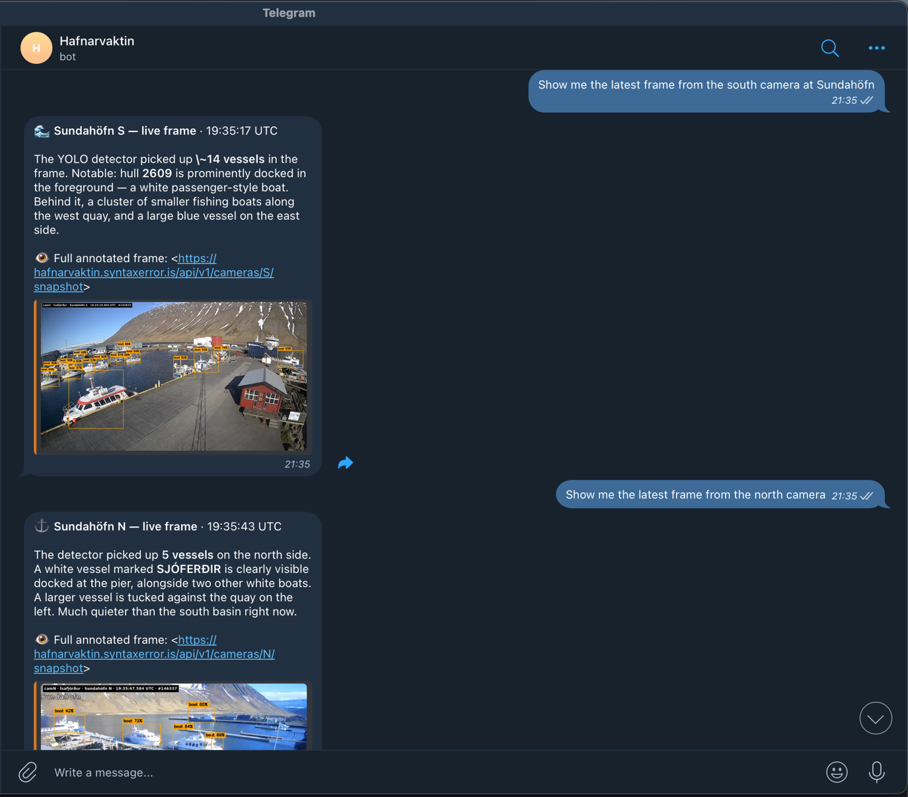
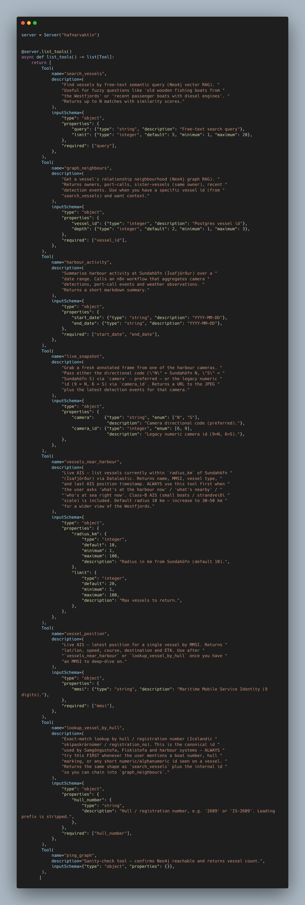
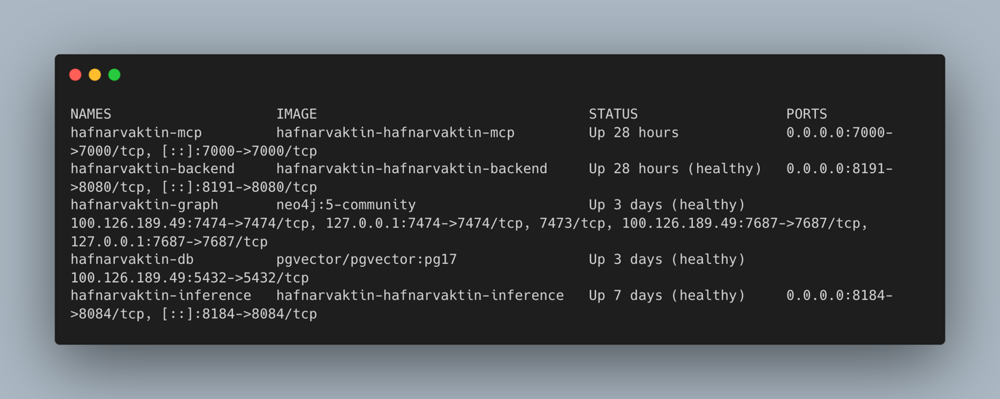
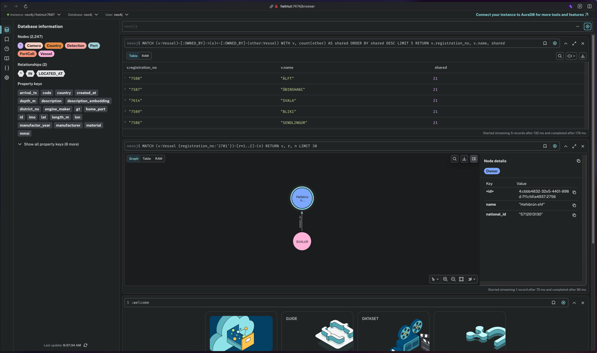
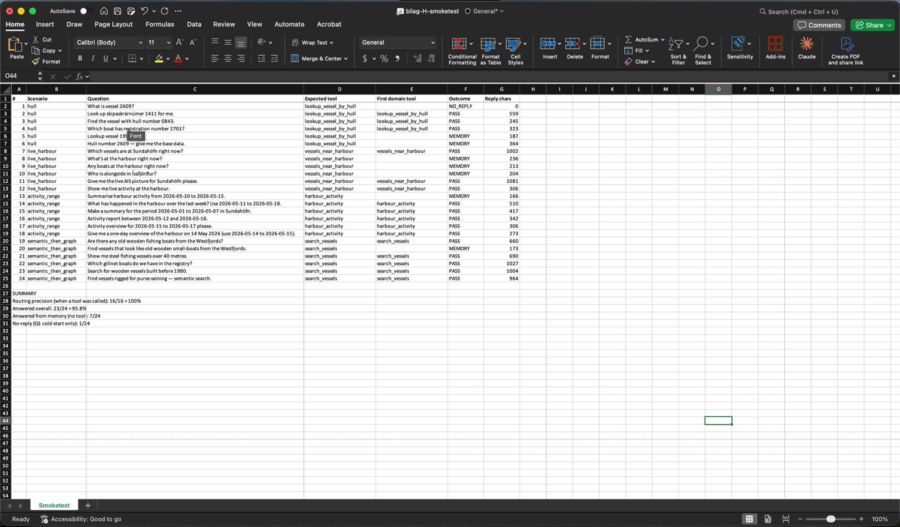

# Hafnarvaktin — AI harbour agent for Sundahöfn

A bounded, conversational **AI agent** that answers natural-language questions about the **remote harbour** at Sundahöfn in Ísafjörður, Iceland — *who is at sea, who is heading home, what is at the dock right now* — over **Telegram** and **Slack**.

Built for the EK *AI Agents & Automations* exam. The four mandatory components — **MCP, n8n, Neo4j vector RAG, Neo4j graph RAG** — each carry their own weight in a real query path.



## The case

Skippers, the harbourmaster and locals ask the same three questions every day and have no local tool to answer them. Hafnarvaktin pulls five complementary data sources behind one agent and answers with **cited evidence** — it never claims a single vessel match with high confidence unless at least two tools agree, because misidentifying a vessel at a commercial harbour has real consequences.

## Architecture

```
User (Telegram / Slack)
       │
  NanoClaw host  ── spawns a short-lived agent container per chat session
       │            (Claude Sonnet 4.6 + MCP client; secrets stay in OneCLI vault)
       │ MCP (SSE)
  hafnarvaktin-mcp  (Python, 8 tools)
   ├─ search_vessels        → Neo4j vector RAG  (e5-base, 768-d)
   ├─ graph_neighbours      → Neo4j graph RAG   (owners · port-calls · sisters)
   ├─ lookup_vessel_by_hull → Neo4j exact hull lookup
   ├─ vessels_near_harbour  → live AIS (Datalastic, 60 s cache in poc/backend)
   ├─ vessel_position       → live AIS for one MMSI (Datalastic)
   ├─ harbour_activity      → n8n webhook → Postgres aggregation
   ├─ live_snapshot         → poc/backend → YOLO11m-annotated camera frame
   └─ ping_graph            → Neo4j health
       │
  Neo4j 5 (graph + vector) · Postgres 17 + pgvector · n8n · Spring Boot poc/backend (+ YOLO11m inference)
```



Backend containers run on a Netcup VPS ("Helmut"); n8n runs as a separate instance behind a Cloudflare Tunnel; NanoClaw runs as a `systemd --user` service.



## Mandatory components

| Component | Where | How it's used |
|---|---|---|
| **MCP** | `mcp-server/server.py` | One Python server exposing all 8 agent tools over stdio/SSE. |
| **n8n** | `n8n-workflows/` | `harbour_activity` aggregation (webhook → Postgres → markdown) **and** Open-Meteo marine-weather ingestion (every 30 min). |
| **Neo4j vector RAG** | `search_vessels` | `db.index.vector.queryNodes('vessel_desc_idx', …)` over **2,239 vessels** embedded with `intfloat/multilingual-e5-base` (768-d). |
| **Neo4j graph RAG** | `graph_neighbours` | Cypher traversal: `(:Vessel)-[:OWNED_BY]->(:Owner)`, sister vessels, and `(:Vessel)-[:VISITED]->(:Port)` GFW port-calls. |



## Data sources

| Source | Content | Ingestion |
|---|---|---|
| **Skipaskrá** (Samgöngustofa / island.is) | Vessel registry: name, type, material, dimensions, owner, home port | Python script → Postgres + mirrored to Neo4j |
| **Global Fishing Watch** | Historical port-visit events | Python script → Postgres `port_calls` → Neo4j `:VISITED` |
| **Datalastic AIS** | Live vessel positions (incl. class-B small boats) | On-demand at query time, **60 s cache** in poc/backend (not persisted) |
| **Open-Meteo Marine** | Wave height, wind, visibility | n8n workflow, **every 30 min** → Postgres `weather_obs` |
| **YOLO11m camera detections** | Boats on 2 Sundahöfn cameras | Continuous inference (~5 fps, conf ≥ 0.30); each appearance collapsed to **one** metadata record via a 3 s debounce → Postgres `detections` |

## Tech stack

- **Agent platform:** NanoClaw (zero-dependency; one bounded agent)
- **Model:** Claude Sonnet 4.6 (credentials in OneCLI vault, never in the agent container)
- **Graph + vector:** Neo4j 5 Community
- **Canonical store:** PostgreSQL 17 + pgvector
- **Automation:** n8n
- **ML:** fine-tuned **YOLO11m** boat detector, served by a Spring Boot `poc/backend`
- **Channels:** Telegram, Slack

## Repository layout

```
ai/
├── AI-Hafnarvaktin.docx  The AI exam report
├── mcp-server/      MCP server (server.py — 8 tools) + Dockerfile + requirements
├── scripts/         Ingestion + enrichment (Skipaskrá, GFW, embeddings, weather)
├── db/
│   ├── migrations/  Postgres schema
│   └── neo4j-init/  Cypher: graph schema + vector index
├── n8n-workflows/   Exported n8n workflows (agent-router, harbour-activity)
├── eval/            Smoke-test harness (run.mjs, questions.json)
├── nanoclaw/        NanoClaw agent platform (fork)
└── bilag/           Appendix images for the report (Bilag A–L)
```

## Reproduce

```bash
# 1. Rebuild the corpus (Postgres + Neo4j)
python3 scripts/gfw-resolve-vessels.py
python3 scripts/gfw-fetch-port-visits.py
python3 scripts/mirror-vessels-to-neo4j.py
python3 scripts/generate-vessel-embeddings.py     # e5-base, 768-d

# 2. Build + run the MCP server (SSE mode)
cd mcp-server
docker build -t hafnarvaktin-mcp:dev .
docker run -d --name hafnarvaktin-mcp \
  -e NEO4J_AUTH="$NEO4J_AUTH" \
  -e ML_BACKEND_URL=http://hafnarvaktin-backend:8080 \
  -e DATALASTIC_API_KEY="$DATALASTIC_API_KEY" \
  -e MCP_TRANSPORT=sse \
  hafnarvaktin-mcp:dev

# 3. Connect NanoClaw to the MCP server and message @hafnarvaktinbot on Telegram.
```

## Evaluation

A 24-question smoke test (4 scenario types × 6 phrasings) drives the agent through the same tool paths a real Telegram user hits. The criterion is correct tool selection on the first turn, verifiable against the underlying source.

**Result: 100 % routing precision** — in every case where the agent invoked a domain tool it chose the correct one (16/16); 23/24 questions answered.



## Report

The full exam report (≤ 5 pages) is [`AI-Hafnarvaktin.docx`](AI-Hafnarvaktin.docx); all appendices (**Bilag A–L**) live in [`bilag/`](bilag/).
