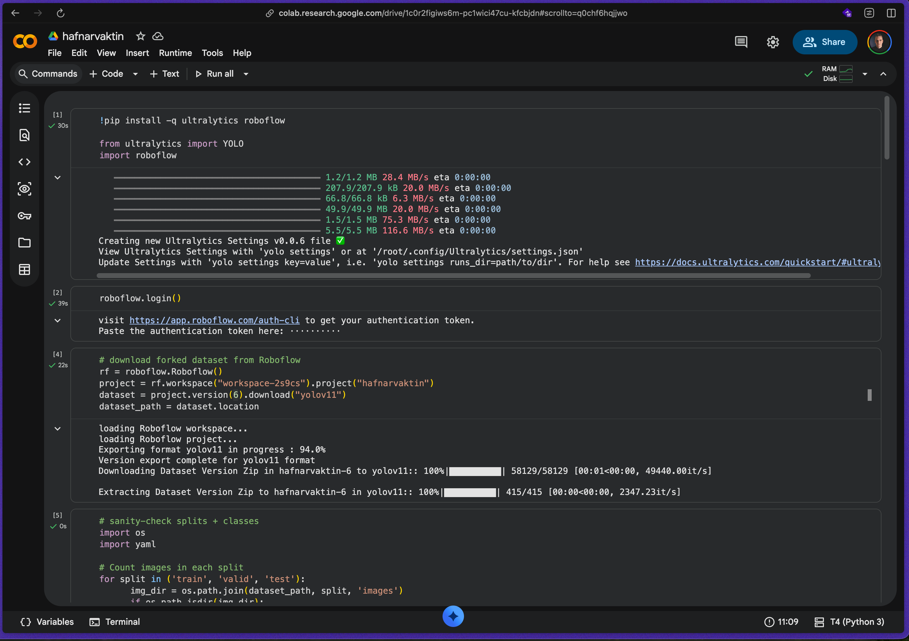
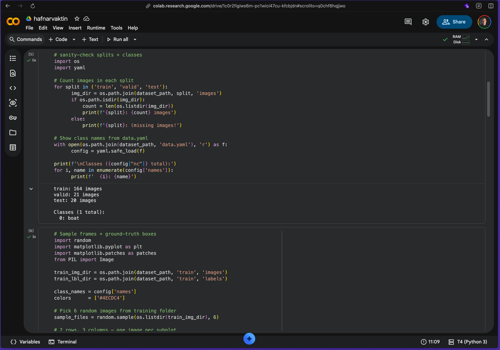
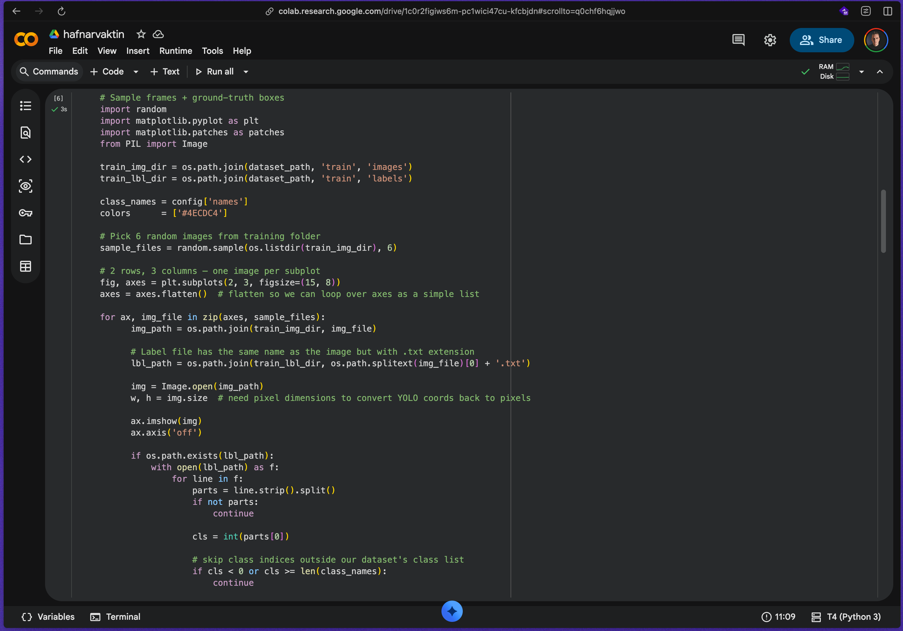
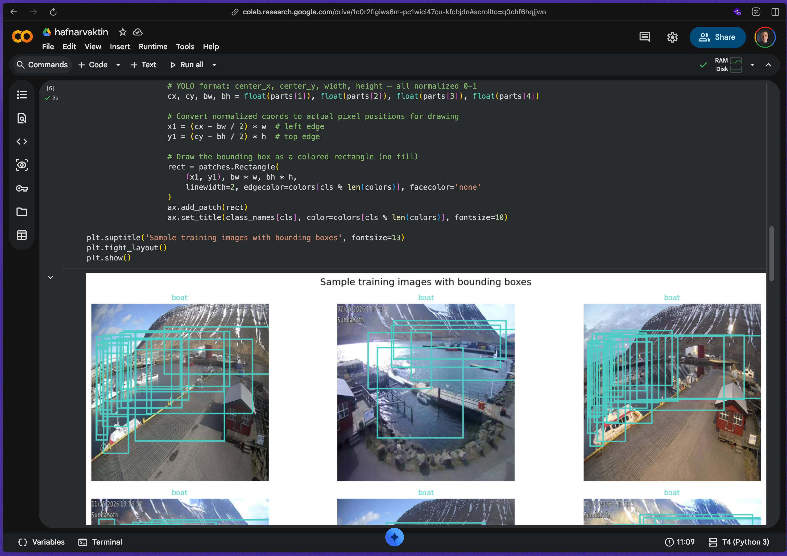
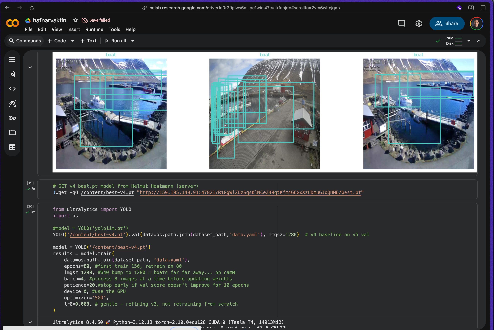
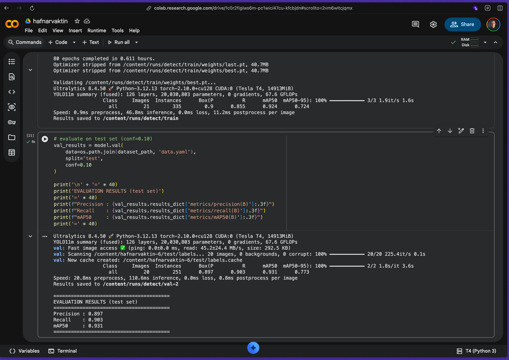
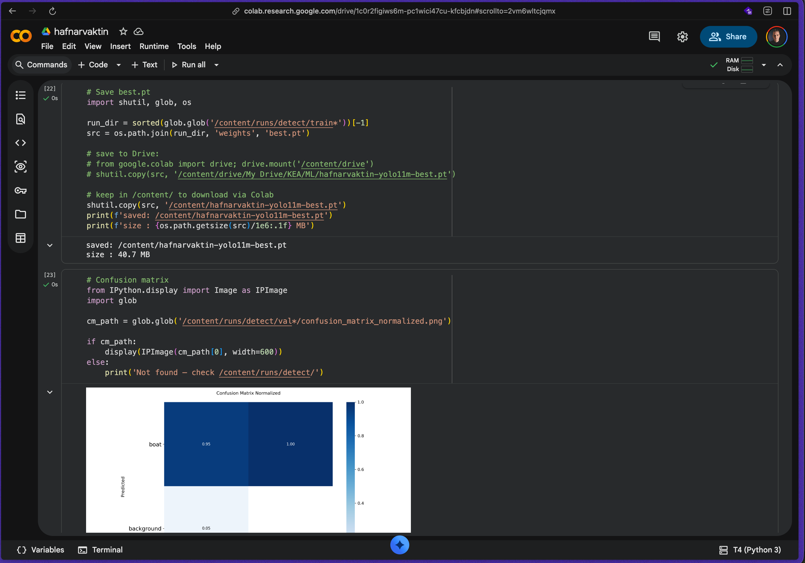
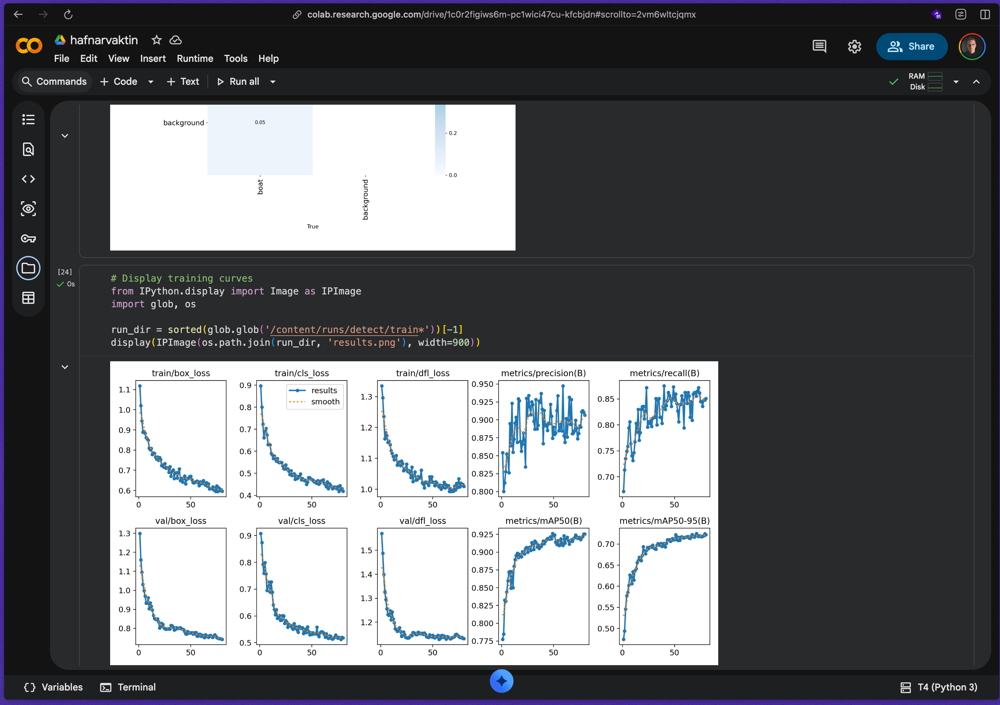
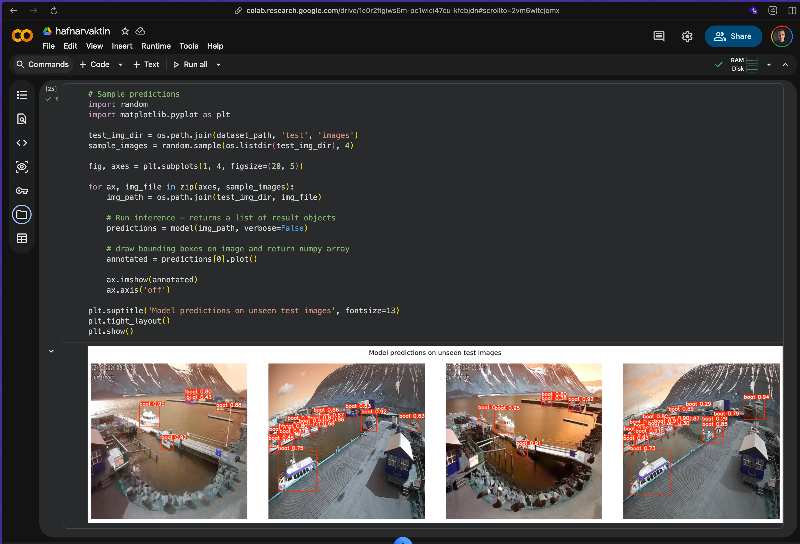

# colab-v5 — training screenshots

Screenshots from the final **v5** Colab training run (yolo11m, single-class
boat, 205 images, Tesla T4) — the run that produced the deployed `best.pt`
(Precision 0.897 · Recall 0.983 · mAP50 0.931).

The **v4** round screenshots were lost, so the appendix keeps only the v3
baseline (`../colab-v3/`) and this final v5 run.

## Walkthrough

The run continues training from the v4 weights pulled off the Helmut server,
so v5 is one more active-learning round on top of v4 rather than a fresh start.

<table>
<tr>
<td align="center" width="33%"><b>1 · Setup</b> install Ultralytics + Roboflow, pull the forked <code>hafnarvaktin</code> dataset (YOLO11 format) </td>
<td align="center" width="33%"><b>2 · Split check</b> train 164 / valid 21 / test 20 images · one class: <code>boat</code> </td>
<td align="center" width="33%"><b>3 · Label reprojection</b> code that draws the YOLO ground-truth labels back as pixel boxes </td>
</tr>
<tr>
<td align="center" width="33%"><b>4 · Ground-truth frames</b> sample Sundahöfn N/S training frames with labelled boxes </td>
<td align="center" width="33%"><b>5 · Resume + train</b> wget v4 <code>best.pt</code> from Helmut → train yolo11m, 80 epochs, imgsz 1280, batch 4, patience 20 </td>
<td align="center" width="33%"><b>6 · Test evaluation</b> <code>val(split='test', conf=0.10)</code> → P 0.897 · R 0.983 · mAP50 0.931 </td>
</tr>
<tr>
<td align="center" width="33%"><b>7 · Export + confusion matrix</b> save the v5 <code>best.pt</code> (40.7 MB) · normalized boat-vs-background matrix </td>
<td align="center" width="33%"><b>8 · Training curves</b> box / cls / dfl loss + precision / recall / mAP50 / mAP50-95 </td>
<td align="center" width="33%"><b>9 · Predictions</b> the trained model on unseen test frames (predicted boxes) </td>
</tr>
</table>
