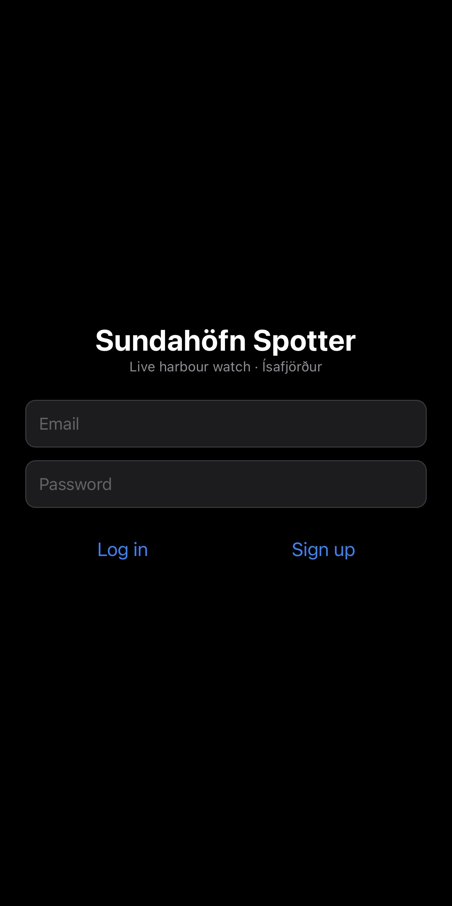
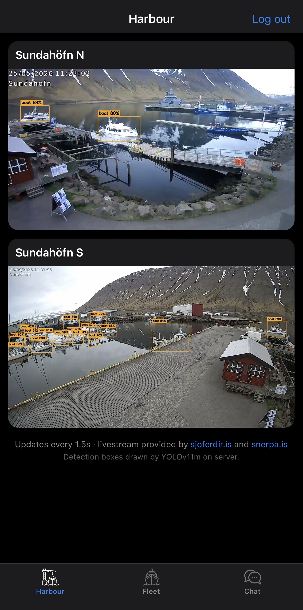
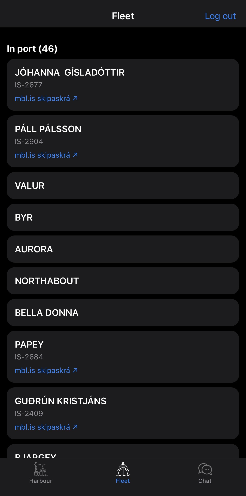
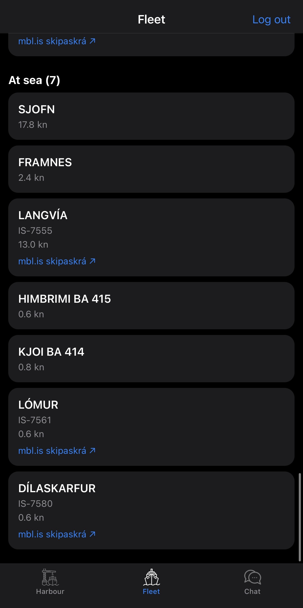
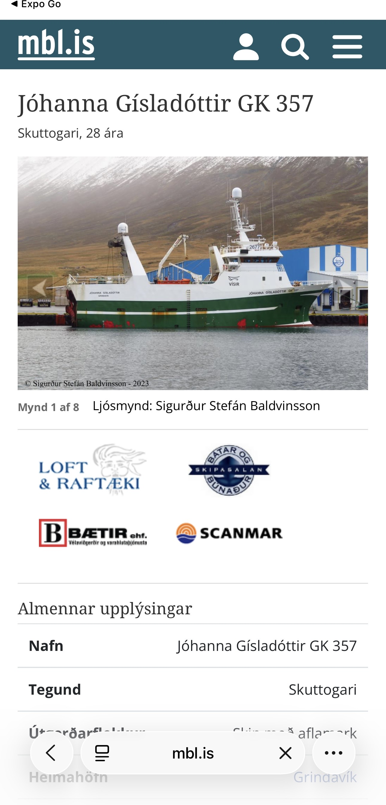
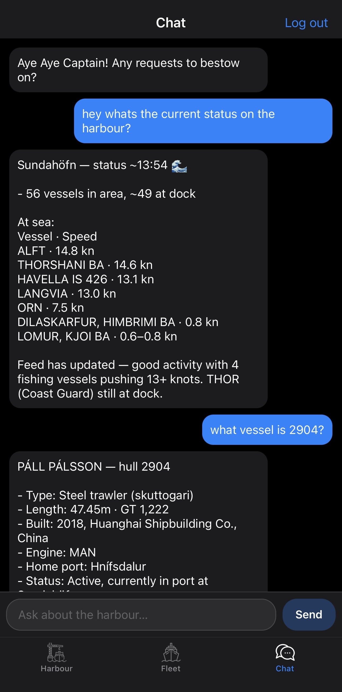
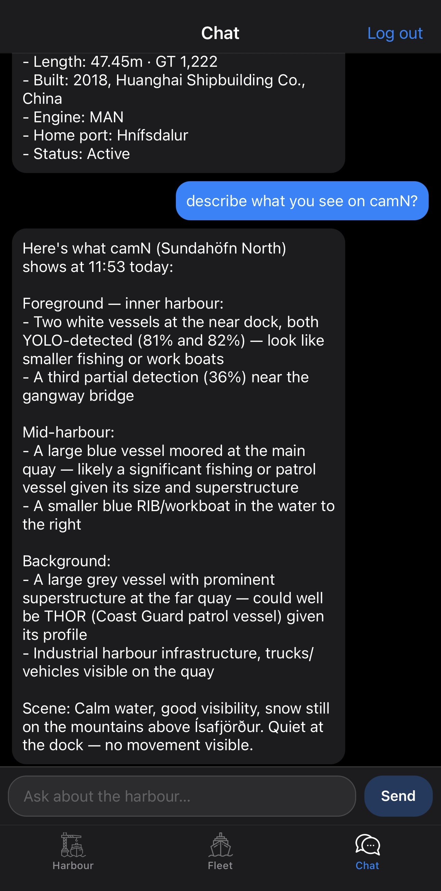

# `rn/` — React Native exam track

The app lives in [`sundahofn-spotter/`](sundahofn-spotter/) — an Expo (React Native) app built as the EK React Native exam project.

## Three tabs

| tab | purpose | backend |
|---|---|---|
| **Harbour** | both Sundahöfn cameras (N=9, S=6) with server-drawn YOLO boxes, polled every ~1.5 s | `poc/backend` snapshot endpoints |
| **Fleet** | Samgöngustofa-backed vessel list split into *In port* / *At sea*; each card shows the skipaskrárnúmer with a deep link to the vessel's mbl.is skipaskrá page, plus live speed for boats at sea | `poc/backend` `/api/v1/vessels/status` |
| **Chat** | ask the harbour assistant about what's been spotted | n8n webhook (`/webhook/chat`) → the AI exam's NanoClaw agent |

The Chat tab is a thin client: it POSTs to the AI exam's n8n webhook, so the same agent answers in the app, on Telegram and on Slack. No agent / RAG code lives in the RN app.

## Screenshots (bilag)

Screenshots from a live run against the Helmut stack (appendix A–G; the source-code / n8n walkthrough is H–M, used in the report).

<table>
<tr>
<td align="center"><b>A · Login</b><br><sub>Firebase email/password gate</sub><br></td>
<td align="center"><b>B · Harbour</b><br><sub>dual live cams + YOLOv11m boxes</sub><br></td>
<td align="center"><b>C · Fleet · in port</b><br><sub>skipaskrárnúmer + mbl.is link</sub><br></td>
<td align="center"><b>D · Fleet · at sea</b><br><sub>live speed (kn) from AIS</sub><br></td>
</tr>
<tr>
<td align="center"><b>E · mbl.is skipaskrá</b><br><sub>deep link from a Fleet card</sub><br></td>
<td align="center"><b>F · Chat · status</b><br><sub>live status &amp; hull 2904</sub><br></td>
<td align="center"><b>G · Chat · camera vision</b><br><sub>describes the cam-N frame</sub><br></td>
</tr>
</table>

## Run

```bash
cd sundahofn-spotter
npm install
npx expo start        # open in Expo Go on an iPhone
```

## Layout

```
rn/
├── sundahofn-spotter/   the Expo app (App.js, screens/, lib/, components/)
├── bilag/               exam appendix — app screenshots (A–G, shown above) + source-code/n8n walkthrough images (H–M, used in the report)
├── README.md            this file
└── exam-requirments.md  the RN course brief
```
